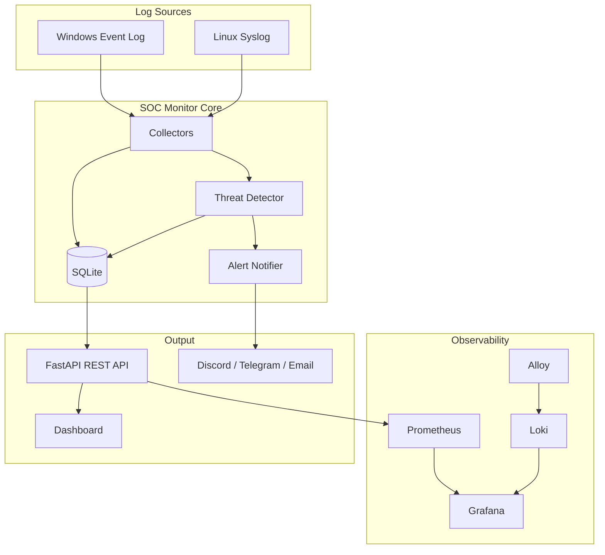

# SOC Monitor — Security Operations Center

<p align="center">
  <strong>Πλατφόρμα παρακολούθησης ασφαλείας και ανίχνευσης απειλών σε πραγματικό χρόνο</strong><br>
  Windows Event Logs · Linux Syslog · Rule-based Detection · Multi-channel Alerts · Web Dashboard
</p>

---

## Περιεχόμενα

- [Επισκόπηση](#επισκόπηση)
- [Αρχιτεκτονική](#αρχιτεκτονική)
- [Δομή Project](#δομή-project)
- [Εγκατάσταση](#εγκατάσταση)
- [Εκκίνηση](#εκκίνηση)
- [Observability Stack](#observability-stack)
- [Dashboard & UX](#dashboard--ux)
- [Κανόνες Ανίχνευσης](#κανόνες-ανίχνευσης)
- [REST API](#rest-api)
- [Δοκιμές & CI](#δοκιμές--ci)
- [Quick Start](#quick-start)
- [Final status](#final-status)

---

## Επισκόπηση

Το **SOC Monitor** είναι ένα ελαφρύ, αυτοτελές Security Operations Center framework γραμμένο σε Python. Συλλέγει logs από Windows ή Linux, τα αποθηκεύει σε βάση δεδομένων, τα αναλύει με rule-based detection engine και εκδίδει ειδοποιήσεις ασφαλείας μέσω Discord, Telegram ή Email.

### Τι κάνει

| Λειτουργία | Περιγραφή |
|-----------|-----------|
| **Log Collection** | Συλλογή από Windows Event Log ή Linux syslog |
| **Threat Detection** | Ανίχνευση brute force, failed login bursts, suspicious processes, privilege escalation |
| **Persistence** | SQLite default persistence με deduplication |
| **Alerting** | Discord, Telegram, SMTP Email |
| **Dashboard** | Web dashboard + REST API |
| **Observability** | Prometheus, Grafana, Loki, Alloy |
| **CI/CD** | Pytest + docker compose validation workflow |

### Tech Stack

- Python 3.11
- FastAPI + Uvicorn
- SQLite
- Prometheus client
- Docker Compose
- Grafana + Loki + Alloy

---

## Αρχιτεκτονική



---

## Δομή Project

```ini
SOC Monitoring & Threat Detection Framework/
├── main.py
├── Dockerfile
├── docker-compose.yml
├── Makefile
├── requirements.txt
├── .env.example
├── README.md
├── metrics.py
├── .github/
│   └── workflows/
│       └── ci.yml
├── api/
│   ├── routes.py
│   ├── dashboard.html
│   └── static/
├── analyzers/
│   └── threat_detector.py
├── alerts/
│   └── notifier.py
├── collectors/
│   ├── linux_collector.py
│   └── windows_collector.py
├── config/
│   └── settings.py
├── grafana/
│   └── provisioning/
│       ├── datasources/
│       └── dashboards/
├── prometheus/
│   └── prometheus.yml
├── loki/
│   └── local-config.yaml
├── alloy/
│   └── config.alloy
├── storage/
│   ├── database.py
│   └── demo_data.py
├── tests/
│   ├── conftest.py
│   ├── test_api.py
│   ├── test_database.py
│   ├── test_detector.py
│   └── test_metrics.py
└── soc_monitor.db
```

---

## Εγκατάσταση

### Προαπαιτούμενα

- Python 3.11+
- Docker + Docker Compose
- Windows: Administrator privileges for Event Log access
- Linux: read access to `/var/log` files

### Βήματα

```bash
cd "C:\Users\usr1\Documents\SOC Monitoring & Threat Detection Framework"
python -m venv .venv
.\.venv\Scripts\activate
pip install -r requirements.txt
```

---

## Εκκίνηση

### Local backend

```bash
python main.py
```

### Docker stack

```bash
docker compose up --build
```

### Helpful commands

```bash
make up
make down
make test
make compose-check
```

---

## Observability Stack

Το σύστημα περιλαμβάνει πλήρη observability stack:

- Prometheus: scraping metrics from `/metrics`
- Grafana: pre-provisioned dashboard for SOC overview
- Loki: centralized log ingestion
- Alloy: file-based log forwarding to Loki

### URLs

| URL | Περιγραφή |
|-----|-----------|
| `http://localhost:8080` | FastAPI app |
| `http://localhost:8080/docs` | Swagger docs |
| `http://localhost:8080/api/health` | Health check |
| `http://localhost:8080/metrics` | Prometheus metrics |
| `http://localhost:9090` | Prometheus UI |
| `http://localhost:3000` | Grafana UI |
| `http://localhost:3100/ready` | Loki readiness |

---

## Dashboard & UX

Το dashboard παρέχει SOC overview, τα δεδομένα της εφαρμογής και βασικούς KPIs μέσω REST API και embedded UI. Η προ-συγκροτημένη Grafana dashboard τοποθετείται αυτόματα μέσω provisioning.

---

## Κανόνες Ανίχνευσης

Οι βασικοί κανόνες περιλαμβάνουν:

- Brute force attack detection
- Failed login burst detection
- Privilege escalation attempt detection
- Suspicious process execution detection
- Port scan detection
- Audit log tampering detection

---

## REST API

Οι βασικές διαδρομές:

- `GET /api/health`
- `GET /api/system/status`
- `GET /api/stats`
- `GET /api/alerts`
- `POST /api/alerts/acknowledge`
- `GET /api/detection-rules`
- `POST /api/detection-rules/{rule_id}`
- `GET /api/events/recent`
- `GET /metrics`

---

## Δοκιμές & CI

Το repo περιλαμβάνει pytest coverage για:

- database persistence
- threat detector logic
- API endpoints
- metrics exposure

GitHub Actions workflow:

- `pytest -q`
- `docker compose config --quiet`

---

## Quick Start

```bash
# install
python -m venv .venv
.\.venv\Scripts\activate
pip install -r requirements.txt

# run tests
pytest -q

# run docker stack
docker compose up --build
```

---

## Final status

Το έργο είναι λειτουργικό, δοκιμασμένο και έτοιμο για local deployment / demo / portfolio παρουσίαση.

### Verified

- `pytest`: 17 passed
- `docker compose config --quiet`: OK

### Deliverable summary

- Python FastAPI application
- SOC event detection engine
- Alerting system
- SQLite persistence
- Metrics and observability stack
- CI validation
- Docker deployment support

Η τεχνολογική βάση είναι έτοιμη για περεταίρω ανάπτυξη σε πιο advanced SIEM / SOC workflows.
mpose stack.

Useful helper commands:

```bash
make up
make down
make test
make compose-check
```

The provisioned Grafana dashboard is auto-loaded from `grafana/provisioning/dashboards` and is available after the stack is running.

---

## Dashboard & UX

Το νέο dashboard προσφέρει επαγγελματική εμπειρία SOC analyst με:

### Ενότητες

| Tab | Περιεχόμενο |
|-----|-------------|
| **Επισκόπηση** | KPI cards, γράφημα events/ώρα, doughnut chart τύπων, Top Source IPs |
| **Ειδοποιήσεις** | Πίνακας alerts με φίλτρα (Όλα / Μη αναγνωρισμένα / Critical / High), ACK, modal λεπτομερειών |
| **Συμβάντα** | Πρόσφατα log events με φίλτρο τύπου |
| **Σύστημα** | Platform, uptime, collector status, notification channels, API reference |

### UX Features

- Dark theme με cyan accent (SOC-style)
- Sidebar navigation (collapsible)
- Keyboard navigation (Arrow keys to move, `c` to toggle sidebar)
- Auto-refresh κάθε 30 δευτερόλεπτα
- Toast notifications για ACK actions και συστηματικά μηνύματα
- Right-hand info panel για λεπτομέρειες alerts/incidents
- Skeleton loaders για μεγάλα πίνακες
- Empty states και εικονογραφήσεις όταν δεν υπάρχουν δεδομένα
- Paginated, resizable tables για Alerts / Events
- Rule editor UI (edit name, severity, description, MITRE mapping)
- Backend: MITRE technique, assigned analyst, incident investigation details
- Responsive layout (mobile-friendly)
- Live connection indicator (Online/Offline)
- Collector error warnings (π.χ. Security log privileges)

---

## Ροή Δεδομένων

### Windows Events

Ο collector παρακολουθεί 30+ Security Event IDs:

| Event ID | Τύπος |
|--------|-------|
| 4624 | Successful login |
| 4625 | Failed login |
| 4688 | Process created |
| 4672 | Special privileges assigned |
| 1102 | Audit log cleared |
| 4720 | User account created |
| 4740 | User account locked |

### Linux Events

Ανάλυση syslog γραμμών από `auth.log`, `syslog`, `secure`:

- `failed_login` — Αποτυχημένη SSH/authentication
- `successful_login` — Επιτυχής σύνδεση
- `sudo_command` / `sudo_failure` — Privilege escalation
- `invalid_user` — Άγνωστος χρήστης

### Database Schema

__`log_events`__ — Όλα τα συλλεγμένα events
__`threat_alerts`__ — Εντοπισμένες απειλές με severity (LOW→CRITICAL)
__`statistics`__ — Aggregated stats (schema ready)

---

## Κανόνες Ανίχνευσης

| Κανόνας | Trigger | Severity | Threshold |
|---------|---------|----------|-----------|
| **Brute Force** | ≥10 failed logins από ίδιο IP | HIGH | 10 events / 60s |
| **Failed Logins** | ≥5 αποτυχίες για συγκεκριμένο user | MEDIUM/HIGH | 5 events / 300s |
| **Privilege Escalation** | sudo failure ή `USER=root` | LOW/MEDIUM | Per event |
| **Suspicious Process** | mimikatz, nmap, powershell -enc, κ.ά. | CRITICAL | Regex match |
| **Audit Log Cleared** | Windows Event 1102 | CRITICAL | Per event |

### Suspicious Process Patterns (25+)

```sh
mimikatz, pwdump, bloodhound, metasploit, nmap, hydra,
hashcat, netcat, psexec, powershell -enc, certutil -urlcache, ...

```

---

## Ειδοποιήσεις

Ρυθμίστε μέσω environment variables (δείτε `.env.example`):

```powershell
# Discord
$env:DISCORD_ENABLED="true"
$env:DISCORD_WEBHOOK="https://discord.com/api/webhooks/..."

# Telegram
$env:TELEGRAM_ENABLED="true"
$env:TELEGRAM_BOT_TOKEN="your-bot-token"
$env:TELEGRAM_CHAT_ID="your-chat-id"

# Email (SMTP)
$env:EMAIL_ENABLED="true"
$env:SMTP_USER="your@gmail.com"
$env:SMTP_PASSWORD="app-password"

```

Κάθε alert στέλνεται με:

- Τύπο απειλής & severity (με χρώμα/emoji)
- Hostname, Source IP, Target User
- Περιγραφή & event count
- Timestamp

---

## REST API

### Endpoints

| Method | Endpoint | Περιγραφή |
|--------|----------|-----------|
| `GET` | `/api/health` | Health check |
| `GET` | `/api/system/status` | Runtime status (uptime, collector, DB counts) |
| `GET` | `/api/stats?days=7` | Aggregated statistics |
| `GET` | `/api/alerts?limit=50&page=1` | Paginated threat alerts (supports `severity` and `acknowledged` filters) |
| `POST` | `/api/alerts/acknowledge` | Acknowledge alert `{"alert_id": 1}` |
| `GET` | `/api/detection-rules` | Detection rules metadata for UI |
| `POST` | `/api/detection-rules/{rule_id}` | Update rule metadata (name, severity, description, mitre_technique) |
| `GET` | `/api/threats/summary?hours=24` | Threat summary |
| `GET` | `/api/events/recent?limit=50` | Recent log events |

### Παράδειγμα — Health Check

```json
{
  "status": "healthy",
  "timestamp": "2026-06-19T18:43:18.723000",
  "components": {
    "database": true,
    "detector": true,
    "notifier": true
  }
}

```

### Παράδειγμα — System Status

```json
{
  "success": true,
  "data": {
    "platform": "Windows",
    "hostname": "DESKTOP-LSRQ070",
    "uptime_seconds": 3600,
    "database_type": "sqlite",
    "collector_type": "Windows Event Log",
    "collector_active": true,
    "collector_channels": ["Security", "System", "Application"],
    "collector_errors": [
      "Cannot open event log Security: (1314, 'OpenEventLogW', '...')"
    ],
    "poll_interval": 10,
    "batch_size": 100,
    "total_events": 5,
    "total_alerts": 0,
    "notifications": {
      "discord": false,
      "telegram": false,
      "email": false
    }
  }
}

```

### Παράδειγμα — Statistics

```json
{
  "success": true,
  "data": {
    "total_events": 5,
    "events_by_type": {
      "event_0": 1,
      "event_10016": 1,
      "event_1014": 1,
      "event_25753": 1,
      "event_8224": 1
    },
    "alerts_by_severity": {},
    "top_source_ips": [],
    "events_per_hour": {
      "18": 5
    }
  }
}

```

---

## Ρυθμίσεις

### Environment Variables

| Μεταβλητή | Default | Περιγραφή |
|-----------|---------|-----------|
| `DB_TYPE` | `sqlite` | `sqlite` ή `postgresql` |
| `PG_HOST` | `localhost` | PostgreSQL host |
| `PG_PASSWORD` | `""` | PostgreSQL password |
| `DISCORD_ENABLED` | `false` | Ενεργοποίηση Discord |
| `DISCORD_WEBHOOK` | `""` | Discord webhook URL |
| `TELEGRAM_ENABLED` | `false` | Ενεργοποίηση Telegram |
| `TELEGRAM_BOT_TOKEN` | `""` | Bot token |
| `TELEGRAM_CHAT_ID` | `""` | Chat ID |
| `EMAIL_ENABLED` | `false` | Ενεργοποίηση Email |
| `SMTP_USER` | `""` | SMTP username |
| `SMTP_PASSWORD` | `""` | SMTP password |

### Code Defaults (`config/settings.py`)

| Ρύθμιση | Default |
|---------|---------|
| API Host/Port | `0.0.0.0:8080` |
| Poll Interval | 10 seconds |
| Batch Size | 100 events |
| Brute Force Threshold | 10 / 60s |
| Failed Login Threshold | 5 / 300s |
| Windows Channels | Security, System, Application |
| Linux Log Paths | auth.log, syslog, secure |

---

## Δεδομένα Runtime (Παράδειγμα)

Παρακάτω πραγματικά δεδομένα από εκτέλεση στο **DESKTOP-LSRQ070** (Windows 10):

### Στατιστικά Βάσης

| Μετρική | Τιμή |
|---------|------|
| Συνολικά Events | **5** |
| Συνολικά Alerts | **0** |
| Hostname | DESKTOP-LSRQ070 |
| Platform | Windows |

### Events ανά Τύπο

| Event Type | Count | Περιγραφή |
|------------|-------|-----------|
| `event_8224` | 1 | VSS service timeout |
| `event_10016` | 1 | DCOM permission (user: usr1) |
| `event_0` | 1 | SynTPEnhService session unlock |
| `event_1014` | 1 | DNS resolution failure |
| `event_25753` | 1 | System event |

### Πρόσφατο Event (παράδειγμα)

```json
{
  "id": 5,
  "timestamp": "2026-06-19 18:43:23",
  "source": "windows",
  "hostname": "DESKTOP-LSRQ070",
  "event_type": "event_8224",
  "event_id": 8224,
  "username": null,
  "source_ip": null,
  "message": "Η υπηρεσία VSS τερματίζεται λόγω υπέρβασης του χρονικού ορίου αδράνειας."
}

```

### Log Output (εκκίνηση)

```csv
2026-06-19 18:43:18 - INFO - Windows Event Log collector initialized
2026-06-19 18:43:18 - INFO - Starting SOC Monitor...
2026-06-19 18:43:18 - INFO - Collection thread started
2026-06-19 18:43:18 - INFO - Starting API server on 0.0.0.0:8080
2026-06-19 18:43:27 - INFO - Processed 2 events, generated 0 alerts
2026-06-19 18:43:42 - INFO - Processed 1 events, generated 0 alerts

```

> **Σημείωση:** Το Security Event Log απαιτεί Administrator privileges. Χωρίς αυτά, συλλέγονται μόνο System & Application events (βλ. Troubleshooting).

---

## Troubleshooting

### Security Event Log — Error 1314

```ini
Cannot open event log Security: (1314, 'OpenEventLogW', 'Το πρόγραμμα-πελάτης δεν διαθέτει κάποιο απαραίτητο δικαίωμα.')

```

**Λύση:** Εκτελέστε `python main.py` ως **Administrator** (δεξί κλικ → Run as administrator). Το dashboard εμφανίζει αυτό το warning στην ενότητα Σύστημα.

### Port 8080 already in use

```powershell
# Αλλάξτε port στο config/settings.py ή σταματήστε την υπάρχουσα διεργασία
netstat -ano | findstr :8080

```

### Δεν εμφανίζονται events στο Dashboard

1. Ελέγξτε ότι ο collector τρέχει (tab **Σύστημα** → Collector: Ενεργός)
2. Ελέγξτε το `soc_monitor.log` για errors
3. Στο Windows, τρέξτε ως Administrator
4. Περιμένετε 10–30 δευτερόλεπτα (poll interval + refresh)

### Notifications δεν στέλνονται

1. Επιβεβαιώστε `DISCORD_ENABLED=true` (ή Telegram/Email)
2. Ελέγξτε τα credentials στο `.env`
3. Δείτε το `soc_monitor.log` για notification errors

---

## License

MIT — Ελεύθερη χρήση για εκπαιδευτικούς και επαγγελματικούς σκοπούς SOC monitoring.

---

<p align="center">
  Built with Python · FastAPI · Chart.js<br>
  <strong>SOC Monitor v1.0</strong>
</p>
